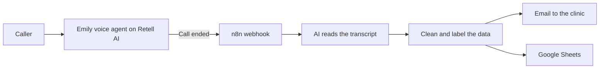
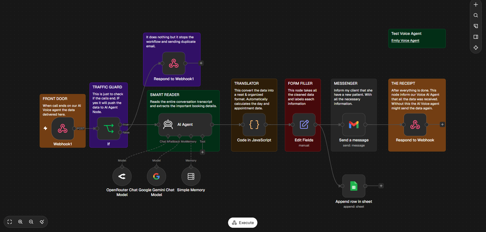

# Agent Emily: AI Dental Receptionist

Emily is an AI voice agent that answers phone calls for a dental clinic. She answers questions about clinic hours, services, and common questions, and she books appointments. Each booking is emailed to the clinic and saved to a Google Sheet.

**Live demo:** https://emily.avtechautomation.online

## How it works

1. **Front Door:** a patient calls and Emily answers on Retell AI. When the call ends, Retell sends the full transcript to an n8n webhook.
2. **Traffic Guard:** an If node checks that the event is `call_ended`. Other events are answered right away and stopped, so no duplicate bookings get sent.
3. **Smart Reader:** an AI Agent reads the transcript and pulls out the booking details as JSON.
4. **Translator:** a JavaScript step cleans the data and works out the day of the week from the appointment date.
5. **Form Filler:** the cleaned data is organized into labeled fields.
6. **Messenger:** Gmail sends the booking details to the clinic, and the same booking is added as a new row in Google Sheets.
7. **The Receipt:** n8n tells Retell the job is done, so the booking is not sent twice.

## Reliability

- **Backup AI model:** if the main model fails, the AI Agent switches to Google Gemini automatically, so the booking still goes through.
- **Duplicate protection:** only `call_ended` events are processed, and every event gets a response so Retell does not resend it.

## Tech stack

- Retell AI for the voice agent
- n8n, self hosted on a VPS, for the backend workflow
- OpenRouter (Llama 3 8B) as the main AI model, with Google Gemini as a backup
- JavaScript for data cleanup and date handling
- Gmail to notify the clinic
- Google Sheets to store bookings

## Files in this repo

| File | What it is |
| --- | --- |
| `emily-booking-workflow.json` | The n8n workflow. Import it in n8n with **Import from File**. |
| `workflow.png` | A screenshot of the workflow in n8n. |

## Setup notes

All email addresses, sheet IDs, and credentials were removed for safety. To use this workflow:

1. Import the JSON file into n8n.
2. Connect your own Gmail, Google Sheets, OpenRouter, and Gemini accounts.
3. Replace `clinic@example.com` with the clinic's email.
4. Pick your own Google Sheet. Set the phone column to **Plain text** so leading zeros are kept.
5. Copy the webhook's Production URL into your Retell agent's webhook settings and select the `call_ended` event.

## Built by

**Arman Viacrucis**, AI Automation Specialist
Portfolio: https://armanai.avtechautomation.online
